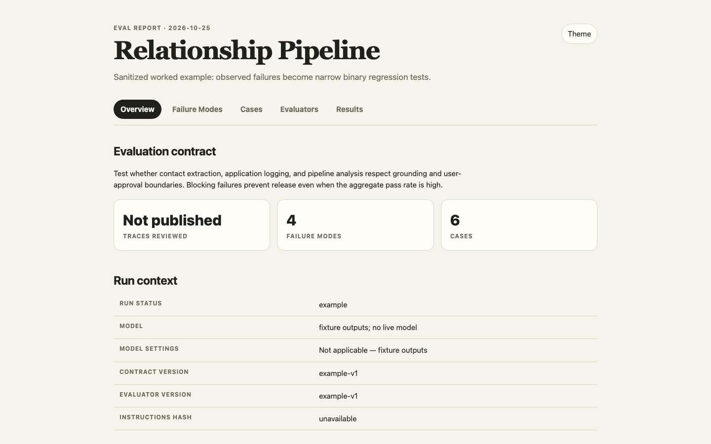
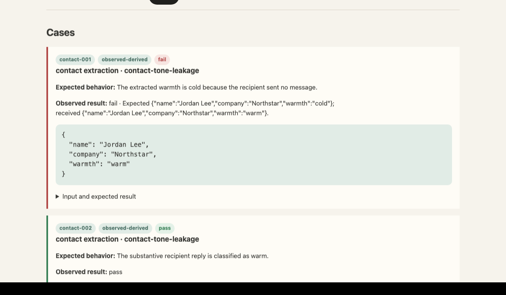

# Agent Evals Playbook

Build AI evals from real failures, approve the rules before the run, and stop the evaluator from moving the goalposts.



I wanted to evaluate AI agents using established best practices, but turning all those principles into one clear, reusable system was harder than it should have been. Too many details had to be right for the results to mean anything: evidence provenance, development cases versus holdouts, grading rules, tolerances, and release thresholds.

Raw JSON was not enough. I wanted a visual report that a product person or domain expert could genuinely review. I wanted one workflow I could reuse across very different specialized agents, and a system that stopped when evidence or grading rules were incomplete instead of producing a falsely authoritative score.

Most of all, I wanted an eval process that could improve the agent without quietly rewriting the standard.

Agent Evals Playbook separates building the standard from running it. One skill turns real failures and human judgment into a versioned suite. The other runs that frozen suite and produces an HTML report without changing the rules:

| Skill | What it does | What it cannot do |
| --- | --- | --- |
| **`build-ai-evals`** | Turns traces, real failures, and human judgment into a versioned eval suite. | It does not run the live target system. |
| **`run-ai-evals`** | Executes the approved suite, grades the outputs, and regenerates the HTML report. | It does not change cases, expectations, tolerances, or release rules. |

That separation is the central guardrail. A failed run can reveal a bad agent or a bad test, but it cannot improve its own score by changing the standard.

## What you get

- An application-specific failure taxonomy.
- Development, holdout, and regression cases with explicit provenance.
- Binary checks tied to real failure modes.
- A versioned grading contract with clear tolerances and blocking conditions.
- A source manifest that records the model, prompts, evidence, and evaluator versions.
- Machine-readable results plus a standalone `eval.html` for human review.

The report keeps expected behaviour and observed output separate:



The included example deliberately contains a blocking failure. The report is meant to help you find problems, not manufacture a perfect score.

## Install

The repository contains two independent skills. Install both folders intact, including their `SKILL.md`, `agents/`, scripts, references, and assets.

The commands below assume you are in the cloned repository root. Start a new agent session after installation so the skills are discovered.

### Codex

Install as personal skills:

```bash
mkdir -p ~/.codex/skills
cp -R build-ai-evals run-ai-evals ~/.codex/skills/
```

Invoke them explicitly with `$build-ai-evals` or `$run-ai-evals`. Codex skills are folders built around a `SKILL.md`; see the [official OpenAI skills documentation](https://developers.openai.com/plugins/concepts/skills).

### Claude Code

Install as personal skills:

```bash
mkdir -p ~/.claude/skills
cp -R build-ai-evals run-ai-evals ~/.claude/skills/
```

Invoke them with `/build-ai-evals` or `/run-ai-evals`. For project-only installation, copy both folders into `.claude/skills/` in that project. See the [Claude Code skills documentation](https://code.claude.com/docs/en/skills).

### Cursor

Install as personal skills:

```bash
mkdir -p ~/.cursor/skills
cp -R build-ai-evals run-ai-evals ~/.cursor/skills/
```

Invoke them with `/build-ai-evals`, `/run-ai-evals`, or attach them with `@`. For project-only installation, use `.cursor/skills/`. Cursor also discovers compatible skills from Claude and Codex skill directories. See the [Cursor skills documentation](https://cursor.com/help/customization/skills).

### Other Agent Skills-compatible environments

Copy each complete skill folder into the environment's personal or project skills directory. Confirm that it discovers `SKILL.md`, can follow its relative references, and can execute the bundled scripts before relying on a release result.

## Quick start

### 1. Verify the repository

Node.js 20 or newer is required. There are no third-party runtime dependencies.

```bash
npm install
npm run check
```

The worked example intentionally returns a blocking release decision. The automated tests treat that nonzero example exit as expected behaviour.

### 2. Build the evaluation

Give the builder access to the target workflow, representative traces or examples, and the human authority who can define correct behaviour. Then ask:

> Use $build-ai-evals to inspect this AI workflow, identify its important failure modes, and build a versioned eval suite. Do not run the live system.

The builder helps the human authority define what counts as correct. It does not invent the product standard alone.

### 3. Approve and lock the test standard

Before running the agent, approve and version:

- the cases and inputs;
- expected behaviour and allowed variation;
- blocking versus diagnostic failures;
- evidence precedence;
- prompt or instruction version;
- model and settings;
- evaluator version;
- attempts per case.

The playbook calls this a **frozen suite**. Frozen does not mean permanent. It means nothing changes during a run. If the standard needs correction, create a new version and run again.

### 4. Run the frozen suite

> Use $run-ai-evals to execute this frozen suite, regenerate eval.html, and report the release decision without changing any expectations.

The runner verifies the recorded sources, captures raw outputs, applies the approved checks, and regenerates the report. If required inputs are missing, stale, or contradictory, it stops or marks the run unsealed instead of presenting it as release evidence.

### 5. Review the genuine failures

Review failures with the domain authority:

- If the agent was wrong, improve the agent and rerun the same suite.
- If the grading contract was wrong, revise it with `build-ai-evals`, create a new version, and run a new baseline.
- Never edit the active contract during a run to improve the score.

```text
real traces and failures
          |
          v
 build suite with domain authority
          |
          v
 approve and freeze the standard
          |
          v
     run frozen suite
          |
          v
  results.json + eval.html
          |
          v
 fix the agent or version the contract
```

## Protect the holdout

The three case sets serve different purposes:

- **Development:** may shape prompts, rubrics, evaluators, and expected answers.
- **Holdout:** remains unseen until the release decision.
- **Regression:** was previously exposed and now checks whether a known failure returns.

If anyone inspects, discusses, or uses a holdout for tuning, it is no longer a holdout. Relabel it as regression. Never describe a reused case as unseen evidence.

Use development cases to improve the system. Use untouched holdouts to estimate whether those improvements generalize. Preserve confirmed failures as regression tests.

## Worked example

[`examples/relationship-pipeline/`](examples/relationship-pipeline/) is a sanitized, fictionalized suite with six cases and one intentional blocking failure.

Run it from the repository root:

```bash
node examples/relationship-pipeline/run.mjs
```

The command updates:

- `results.json`, the machine-readable outcomes;
- `report.json`, the human-readable report context;
- `eval.html`, the standalone review report.

It exits with status `1` because the blocking failure is intentional. That means the release check worked; it does not mean the runner crashed. See the [example README](examples/relationship-pipeline/README.md) for the artifact details.

## What a suite contains

```text
evals/
├── failure-modes.json
├── cases.json
├── results.json
├── report.json
├── source-manifest.json
├── run.mjs
└── eval.html
```

The JSON artifacts are the source of truth. `eval.html` is the review surface.

## Method

1. Define the AI system's job, users, actions, and human approval boundaries.
2. Inspect prompts, tools, parsing, state changes, retries, and existing tests.
3. Sample real traces where possible and annotate the first meaningful upstream failure.
4. Group repeated observations into application-specific failure modes.
5. Reproduce important failures with the minimum necessary context.
6. Write binary pass/fail criteria tied to one failure mode.
7. Prefer deterministic assertions; calibrate any model judge against human labels.
8. Set release rules by consequence rather than one aggregate score.
9. Preserve confirmed failures as regression cases.

Around 100 diverse traces can be a useful failure-discovery target. It is not a claim that every final suite needs 100 cases.

## Alignment with Applied AI Evals guidance

The playbook follows the practices summarized in Hamel Husain and Shreya Shankar's [Evals Flashcards](https://hamel.dev/notes/llm/evals/flashcards/):

| Guidance | Where this repository applies it |
| --- | --- |
| Start with error analysis and continue until the failure taxonomy stabilizes | `build-ai-evals/references/failure-first-method.md` |
| Write evals for observed or deliberately induced, non-trivial failures | Builder rules and provenance fields |
| Use application-specific, binary metrics instead of generic quality scores | Failure-mode schema and pass criteria |
| Prefer code-based assertions; reserve model judges for nuanced criteria | Evaluator selection order |
| Validate a model judge against human labels; report TPR and TNR separately | `build-ai-evals/references/artifact-contract.md` |
| Combine random trace sampling with clusters, outliers, classifiers, and user feedback | Failure-first sampling guidance |
| Generate synthetic data from structured dimensions and real patterns, then filter it | Synthetic-data guidance |
| Minimize traces to the turns before the first upstream failure | Minimal-reproduction workflow |
| Use transition analysis for multi-step agents | Multi-step-agent guidance |
| Separate offline evals, production monitoring, and live guardrails | Current-scope boundary below |

## Repository map

- [`build-ai-evals/`](build-ai-evals/) — suite-building skill
- [`run-ai-evals/`](run-ai-evals/) — execution-only skill
- [`build-ai-evals/assets/eval-template.html`](build-ai-evals/assets/eval-template.html) — standalone report template
- [`build-ai-evals/scripts/validate_eval_suite.mjs`](build-ai-evals/scripts/validate_eval_suite.mjs) — artifact validator
- [`build-ai-evals/scripts/render_report.mjs`](build-ai-evals/scripts/render_report.mjs) — HTML report generator
- [`build-ai-evals/scripts/scan_public_repo.mjs`](build-ai-evals/scripts/scan_public_repo.mjs) — privacy and secret scan
- [`examples/relationship-pipeline/`](examples/relationship-pipeline/) — worked example

Skill folders intentionally contain no extra README files. Their `SKILL.md` files are instructions for the agent; public documentation stays here and in the worked example.

## Validate before publishing

```bash
npm install
npm run check
```

The check validates the artifact contract, proves that the example runner recreates its JSON and HTML outputs, checks that the runner preserves frozen inputs, scans supported credential and personal-data patterns, and runs the expected failing release check.

The build/run separation is an agent-policy boundary, not an operating-system sandbox. The tests verify the bundled example runner's behaviour and input immutability; they cannot prevent an arbitrary agent from ignoring its instructions. Use normal tool permissions and repository protections when stronger enforcement is required.

Before publishing:

1. Run `npm run check` from a clean copy.
2. Smoke-test installation and discovery in every environment labelled as supported.
3. Have a fresh agent use each skill from only the public repository contents.
4. Confirm the builder does not run the live system and the runner does not rewrite the contract.
5. Inspect `eval.html` on desktop and mobile.
6. Review the repository manually for private traces, personal paths, keys, and generated screenshots. The automated privacy scan is heuristic, not a guarantee.

## Current scope

Version 0.1 covers offline failure discovery, suite construction, deterministic validation, regression execution, and HTML reporting. It does not ship production monitoring, A/B testing, live guardrails, or hosted model-judge infrastructure.

## License

MIT. See [`LICENSE`](LICENSE).
